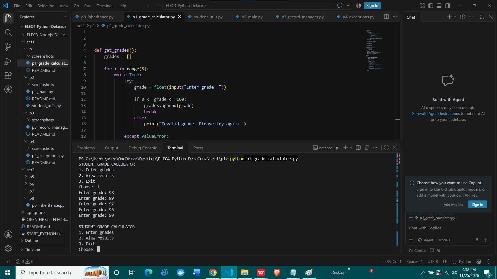
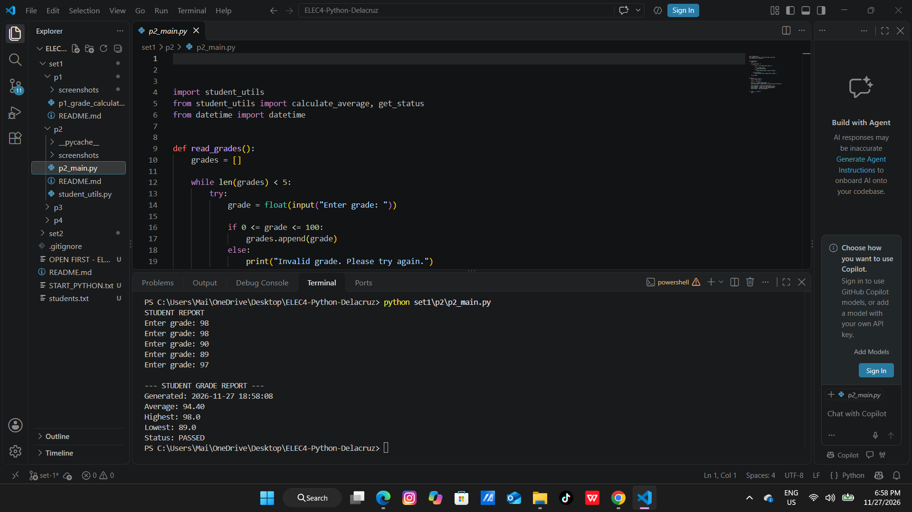
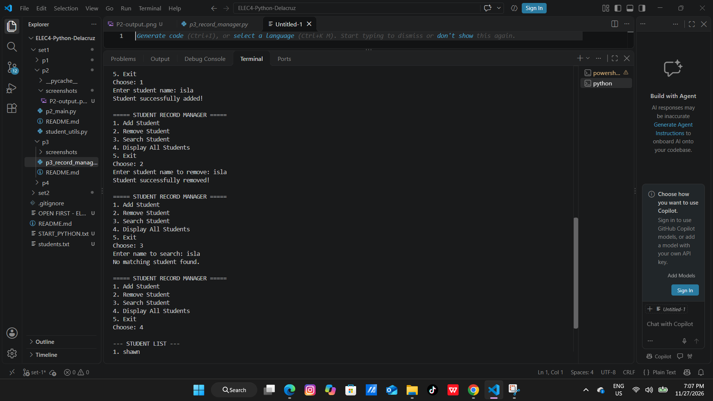
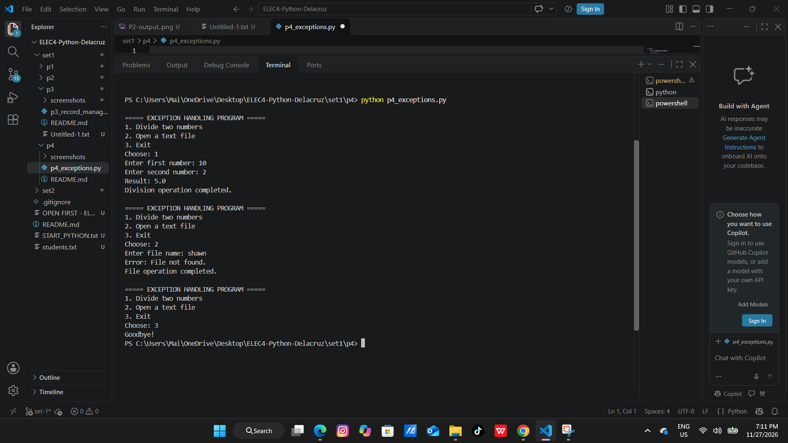

# ELEC 4 – Python Programming Activities

**Student:** Shawn Isla M. Dela Cruz  
**Section:** IV-BSIT-A  
**Course:** ELEC 4 – Python Programming

## Set 1 – Python Programming Activities

| Activity | Description | Folder | Run Command |
|---|---|---|---|
| P1 | Student Grade Calculator using Functions | [P1](set1/p1/) | `python set1/p1/p1_grade_calculator.py` |
| P2 | Custom Student Utility Module | [P2](set1/p2/) | `python set1/p2/p2_main.py` |
| P3 | Student Record Manager using Lists and Sets | [P3](set1/p3/) | `python set1/p3/p3_record_manager.py` |
| P4 | Safe Menu and Exception Handling | [P4](set1/p4/) | `python set1/p4/p4_exceptions.py` |

## Screenshots

### P1 – Student Grade Calculator

### P2 – Custom Student Utility Module

### P3 – Student Record Manager

### P4 – Exception Handling

## Instructions

1. Install Python 3.
2. Open this repository folder in Visual Studio Code.
3. Open the terminal at the repository root.
4. Run the activity using its corresponding Python command listed above.

## Notes

- Each activity contains its own Python source file and README documentation.
- Screenshots show the actual program outputs.
- Python 3 is required.
- Run commands from the repository root directory.